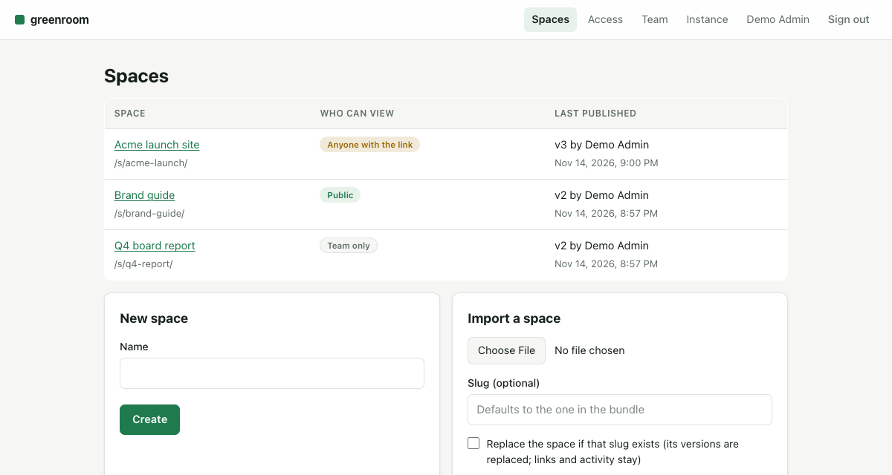
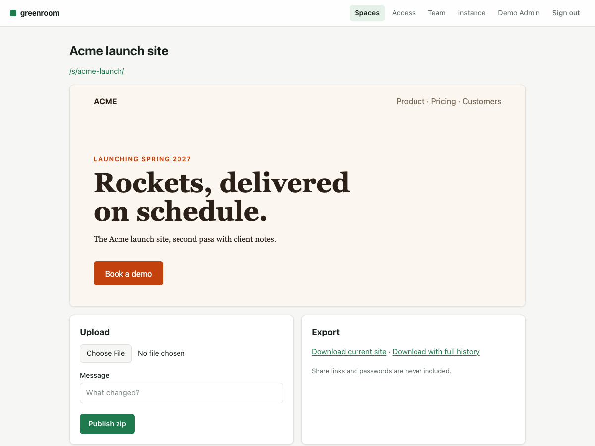
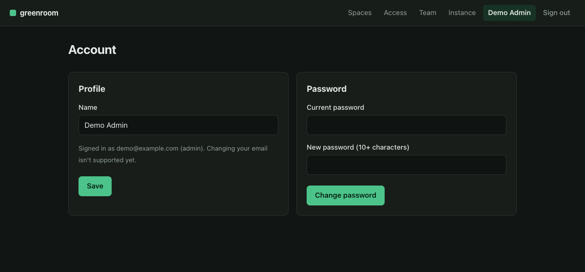

# greenroom

A small, self-hosted place for a team (3–10 people) to host the things their LLM agents make: reports, dashboards, prototypes, docs. Publish a folder of static files, get a URL, keep every version, roll back in a click.

- **Static spaces** served at `/s/{slug}/`, with clean URLs, `_redirects` and `_headers`.
- **Versioned**: every publish is an immutable version over a content-addressed blob store; "live" is a pointer. Rollback makes a new version.
- **Team login** with a dashboard: spaces, history, diffs, zip upload, invites, who-can-view.
- **Agents over MCP**: point an MCP client at `/mcp`; it signs in with OAuth and asks a team member for scoped access. Pasted tokens work too. History shows who did what, e.g. "Claude (via Ada)".
- **One file of state**: SQLite (`node:sqlite`) plus a blob directory. No native dependencies, no timers, no background workers.
- Node 24+, GPL-3.0-or-later.







This release covers milestones M0–M6: the core, OAuth and MCP, client sharing (share links, passwords, expiry, view tracking, branding), portability (export and import), and plugins (an API, a `sqlite` plugin and a `watermark` reference plugin; see [docs/writing-a-plugin.md](docs/writing-a-plugin.md)), and people (SMTP, domain self-signup, offboarding, email re-confirmation). Subdomain mode and a publishing CLI are not built yet.

## Run it

```bash
node bin/greenroom.js serve          # http://127.0.0.1:8080
```

Open it, create the admin account at `/setup`, then invite your team from the Team page. Put a TLS-terminating proxy in front for real use (the session cookie is `Secure`; browsers allow it on `localhost` for trying things out). A sample unit file is in `deploy/greenroom.service`.

| Variable | Default | |
|---|---|---|
| `GREENROOM_DATA_DIR` | `./data` | database, blobs, signing secret |
| `HOST` / `PORT` | `127.0.0.1` / `8080` | |
| `GREENROOM_PUBLIC_URL` | | used for invite and email links and as the OAuth issuer; set it in production |
| `GREENROOM_TRUST_PROXY` | | `1` behind a proxy that sets `X-Forwarded-For`, so login throttling sees real client IPs |
| `GREENROOM_MAX_UPLOAD_BYTES` | 200 MB | also `..._MAX_IMPORT_BYTES` (bundle imports, default 3 × space size + 64 MB), `..._MAX_FILE_BYTES`, `..._MAX_SPACE_BYTES`, `..._MAX_TOTAL_BYTES` |

It idles at well under 100 MB of RAM; `npm test` boots it with a 256 MB heap cap and checks RSS.

## Security model: path mode

Spaces share one origin with the dashboard, so isolation is enforced by headers, not by hostnames:

1. Every response under `/s/` carries `Content-Security-Policy: sandbox allow-scripts allow-forms allow-popups allow-modals allow-downloads`, so each page runs in an opaque origin (no `allow-same-origin`, no top navigation). Also `nosniff` and `Referrer-Policy: no-referrer`.
2. `_headers` can't set CSP, `Set-Cookie`, `Service-Worker-Allowed`, `Cross-Origin-*` or `Access-Control-*`; they're dropped with a warning when the version is finalised.
3. The dashboard session cookie is `__Host-gr_session; HttpOnly; Secure; SameSite=Strict`.
4. State-changing requests need a CSRF token and `Sec-Fetch-Site: same-origin`; `Origin: null` is refused. Bearer-token requests are exempt.
5. Cookies set by plugins are rewritten to `Path=/s/{slug}/` with a per-space name prefix.
6. Viewing a non-public space uses a viewer cookie bound by HMAC to that space's id. A cookie for one space is useless on another, and removing a member revokes access immediately.
7. Per-document write tokens for the future data API are injected into documents only.
8. The dashboard's preview iframe has a `sandbox` attribute without `allow-same-origin`.

Rule 5 applies to plugin routes: core rewrites every cookie a plugin sets, and sets none itself.

Trade-offs you will notice: pages can't use their own `localStorage` or cookies (they're sandboxed), and absolute paths like `/app.css` must become relative (`app.css`) or be mapped with `_redirects`.

## Who can view a space

Each space is **Team only** (the default), **Anyone with the link**, or **Public**. Team members can always view. A space's **Settings** card (at the bottom of its page) renames it, changes its slug (old `/s/{slug}/` links stop working), or deletes it after a confirmation.

- **Team only.** Opening a space while signed in sets a short-lived viewer cookie (`GREENROOM_VIEWER_MINUTES`, default 60) bound to the space and the dashboard session, because the Strict dashboard cookie doesn't reach sandboxed subresource requests. Signing out ends it.
- **Anyone with the link.** Each space can have several links, each with a label, optional expiry, password and max uses. Expiry is either `expires_in` (`30m`, `12h`, `7d`) or `expires_at`, an ISO-8601 date and time with a timezone (not both), at most a year out. The dashboard offers 1 day, 1 week, 30 days or a custom local date and time, which its script sends as UTC. Opening `/s/{slug}/?key=…` checks the link, sets a viewer cookie bound to the space and that link (`Path=/s/{slug}/; HttpOnly; Secure; SameSite=None`), then redirects to the URL without the key. The cookie lasts until the link expires or the session length (`GREENROOM_SESSION_DAYS`, default 30), whichever is sooner. The link row is checked on every request, so revoking or expiring a link cuts off its cookies at once. Keys are stored as sha256, so the full URL is shown only once, when the link is created. A use is spent when a cookie is issued, not per view. A link with a password or max uses shows a page with an Open button, and only that page's POST spends a use, so link previews (Slack, Outlook Safe Links) and HEAD requests never burn one. Those forms refuse cross-site posts. Passwords need at least 8 characters. Attempts are limited to 10 per 15 minutes per link and client IP, and 50 an hour per link across all IPs. Each link records `first_viewed_at`, `last_viewed_at` and `view_count`. A view is a successful page load, counted at most once a minute.
- **Public.** No check. `X-Robots-Tag: noindex` is on unless you turn off "hide from search engines".

Switching a space away from "Anyone with the link" pauses its links. When a person switches it back, they are restored with their counts; when an agent does, they stay paused. Creating a link on a team-only space switches it to "Anyone with the link" and enables only the new link; a person can resume paused links one at a time from the dashboard. A Public space takes no share links and drops `?key=` from the URL. The password, not-found and expired-link pages use the instance branding (agency name, logo URL, accent colour) set on the Instance page.

## Agents: MCP and OAuth

The MCP endpoint is `POST /mcp` (Streamable HTTP, JSON responses). Tools: `list_spaces`, `get_space`, `create_space`, `publish`, `read_file`, `list_versions`, `diff_versions`, `rollback`, `create_share_link`, `revoke_share_link` (both need `share`; creating a link switches a team-only space to "Anyone with the link" and says so in a `note`; it fails on a Public space). `export_space` (needs `export`; returns a download link valid for 10 minutes, bound to that space and that credential, and dead if either is revoked or deleted).

Every way in — dashboard session, OAuth access token, pasted `gra_` token — resolves to one credential object before any route runs, and every check reads only that.

- **Discovery.** An unauthenticated `/mcp` call gets `401` with `WWW-Authenticate: Bearer resource_metadata=…` (RFC 9728), which points at `/.well-known/oauth-authorization-server` (RFC 8414).
- **Clients** identify themselves with a Client ID Metadata Document: `client_id` is an https URL whose JSON lists its name and redirect URIs. It is fetched with public addresses only (checked at connect time, so DNS rebinding can't reach private ranges), no redirects, 64 KB and 5 s limits. Dynamic client registration is off unless an admin turns it on (Instance page).
- **Authorization code + PKCE (S256 only).** The consent screen shows the client's name and metadata URL, a space picker, a "can create spaces" toggle and a permission picker. Codes live two minutes and work once; replaying one revokes what it issued.
- **Tokens** are opaque, stored as SHA-256 hashes, and found with one indexed lookup. Access tokens last an hour. Refresh tokens rotate on every use; presenting a spent one revokes the whole grant.
- **One grant per member and client**, stored as a row in the same table as pasted tokens, so the Access page lists both, grouped by client. Revoking a grant kills its access and refresh tokens at once. Asking for more (`insufficient_scope` → re-consent) widens the same grant.
- **The granter is live.** Deactivate a member (or let their email re-confirmation lapse) and every grant and token they approved stops working.
- **Scopes:** `space:{slug}`, `spaces:create`, `publish`, `db`, `share`, `export`, `read`. Any other string fails the request. A tool call outside the credential's scope returns `403` with `WWW-Authenticate: Bearer error="insufficient_scope", scope="…"` naming what to ask for.
- A space an agent creates joins that agent's grant, and only that one.

Anything that escalates privileges needs a person's own signed-in session, never a scoped credential: inviting people, deactivating users, minting tokens, approving OAuth grants, instance settings, and making a space public. No MCP tool does any of these.

## People

All of this is on the **Instance** and **Team** pages, admins only.

- **Email (SMTP).** Host, port, implicit TLS (465) or STARTTLS (587), username, password and from-address, plus a **Send test email to me** button. The client is built in (`src/mail.js`, no dependencies): plain-text mail, a timeout on every step, and any header value containing CR or LF is refused. Unencrypted SMTP is allowed only to a relay on the same machine. The password is encrypted at rest with a key derived from `secret.key`; it is never shown again, returned by the API or logged. Leave the field blank to keep it; changing the host, port, security or username requires entering it again.
- **Self-signup** is off by default and can be turned on only once SMTP works. List the email domains allowed to sign up. Matching is exact and case-insensitive; a subdomain must be listed separately, and international domains are matched in punycode. `/signup` answers "check your inbox" for every well-formed address, so it can't be used to find out who has an account. A new address at a listed domain gets a link valid for 30 minutes that works once. An address that already has an account gets a "you already have an account" email instead. The link creates a **member**, never an admin. Requests are limited per IP and per address and recorded in the activity log. Removing a domain doesn't deactivate anyone who already signed up.
- **Your account.** Click your name in the header to change your display name or password. Changing the password needs the current one and signs out your other sessions; pasted tokens and OAuth grants are separate and stay, so revoke those on the Access page if needed. Agent tokens can't change either. Changing your email isn't supported yet.
- **Password resets.** **Reset password** on the Team page shows a link once. Send it to the person yourself; no email is needed. It is valid for 24 hours and works once. Using it signs them out everywhere, and making a new link cancels the old one. An admin locked out of the dashboard can run `node bin/greenroom.js reset-link <email>` on the server, as the user that owns the data directory, to get the same kind of link.
- **Roles and invites.** Change someone's role from the Team page. The last active admin can't be made a member. Open invites are listed with who made them and when they expire, and each can be revoked.
- **Offboarding.** **Deactivate** on the Team page stops that person's sessions, pasted tokens and OAuth grants immediately (MCP, the API, everything), because every credential is checked against its owner on each request. Nothing they made is deleted. **Reactivate** lets them sign in again, but old sessions stay signed out. Their unused invites are cancelled, and an invite from someone who is no longer active can't be accepted. The last active admin (lapsed ones don't count) can't be deactivated.
- **Email re-confirmation** (optional, needs SMTP). Set *N* days and each person must confirm their address every *N* days. It is checked when they sign in and whenever one of their credentials is used; there are no timers. When it lapses, their credentials stop working. Signing in with the right password emails a confirmation link, and confirming restores access. Turning it on, lowering *N*, or re-adding SMTP after it was removed gives everyone a fresh *N* days. The Team page shows **lapsed** and **deactivated**.
  If every admin lapses and mail is broken, turn re-confirmation off from the server with `sqlite3 data/control.db "UPDATE meta SET value = json_set(value, '$.reconfirmDays', 0) WHERE key = 'people'"` and restart.

## Export and import

Each space page has **Download current site** (`{slug}.greenroom.zip`) and **Download with full history**
(`{slug}.greenroom-history.zip`, which adds every version, the activity log and a `git fast-import` stream). The Spaces page
has an **Import** card that takes either file; an existing slug is never overwritten unless you tick Replace.
Share links, passwords and tokens are never exported. Format, limits and what is left out: [docs/bundle-spec.md](docs/bundle-spec.md).

## Moving to Spacefast

Done self-hosting? **Instance → Move to Spacefast** copies spaces to Spacefast over its public
API. Mint an API key on the target that can create spaces and publish, paste it with the API address, pick spaces, and
choose live versions only or full history (replayed oldest first; only the version live here goes live there). The key is
used for that run only and never saved. Team and link-only spaces arrive private, public ones public. A slug already taken
on the target is skipped and reported. Nothing here is changed or deleted. People, share links, plugin data and original
dates are not carried over; the report at the end lists what moved.

## Develop

```bash
npm test           # node:test, no dependencies to install
npm run check      # fails if anything imports outside this directory
```

See `CONTRIBUTING.md`.

## AI disclosure

This project was written with substantial help from Claude (Anthropic) via Claude Code, working from a human-written specification. A person directed the work and is responsible for it; the tests and the security model above are the things to review first.

## Plugins

Plugins are off until an admin turns them on (Instance page, or `POST /api/admin/plugins/:name`), and each space then opts in on its own page (`PUT /api/spaces/:slug/plugins/:name`, session only). Bundled: `sqlite` (a per-space SQLite database with a table-by-table browser policy, MCP tools and version-linked snapshots) and `watermark` (a client banner on share-link views). Extra plugins load from `GREENROOM_PLUGINS=/path/a.js,/path/b.js`. Plugins never see the core database or any credential, and can't relax the CSP, cookie or CORS rules. Their files go in both export zips; a plugin missing on the importing instance keeps its data and warns. See [docs/writing-a-plugin.md](docs/writing-a-plugin.md).
